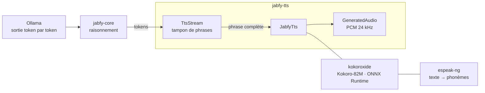

# jabfy-tts

La crate TTS de Jabfy : elle convertit en parole la sortie texte d'Ollama, entièrement en local, via [kokoroxide](https://crates.io/crates/kokoroxide) — une implémentation Rust du modèle Kokoro-82M. Aucune clé d'API, aucun service externe.

## Rôle dans l'architecture

jabfy-tts est une bibliothèque Rust : le composant qui l'utilise l'embarque dans son processus.

| Composant | Relation avec jabfy-tts |
|---|---|
| jabfy-core | Consommateur prévu : il pousse la sortie d'Ollama dans `TtsStream` et joue chaque `GeneratedAudio` produit. |
| kokoroxide | Moteur de synthèse sous-jacent : jabfy-tts n'est qu'une surcouche ergonomique au-dessus de lui. |
| espeak-ng | Dépendance système de kokoroxide : conversion texte → phonèmes, requise au build et à l'exécution. |
| Assets Kokoro | Modèle ONNX, `tokenizer.json`, fichiers voix `.bin` : téléchargés à part, jamais embarqués dans la crate. |

## Pages

| Page | Contenu |
|---|---|
| [Installation et lancement](installation.md) | Prérequis, espeak-ng, assets du modèle, installation, publication |
| [Fonctionnement interne](fonctionnement.md) | Couches, flux d'une synthèse, streaming, choix d'implémentation |
| [Interfaces](interfaces.md) | API publique : `JabfyTts`, `TtsStream`, types et ré-exports |
| [Voix](voix.md) | Fichiers de voix disponibles et convention de nommage |
| [Dépannage](depannage.md) | Erreurs de build, de liaison, de synthèse et de streaming |
| [Tests](tests.md) | Vérifications locales, CI et publication |
| [Documentation du code](code/README.md) | Carte des fichiers source, une page par fichier |

## Deux façons de l'utiliser

- **Ponctuelle** : `tts.synthesize(texte, options)` synthétise une chaîne complète et renvoie un `GeneratedAudio`.
- **En flux** : `tts.stream(options)` renvoie un `TtsStream` qui tamponne les tokens poussés via `push` et synthétise l'audio dès qu'une phrase est terminée — pensé pour la sortie token par token d'Ollama.

Voir [Interfaces](interfaces.md) pour les signatures et [Fonctionnement interne](fonctionnement.md) pour le détail du tampon.

## État actuel

Au 27/10/2026 :

- La migration TypeScript → Rust (kokoro-js → kokoroxide) est sur la branche `tts-10-rust-refractor`, non fusionnée dans `main`.
- La CI vérifie le formatage, clippy et le build release sur chaque pull request vers `main`.
- La création d'une release GitHub déclenche le workflow de publication crates.io.

## Limites connues et TODO

- [ ] La crate dépend d'un fork git de kokoroxide (branche `ort_v2_migration`) : `cargo publish` refuse les dépendances git sans version, donc la publication crates.io restera bloquée jusqu'au merge de [la PR upstream](https://github.com/dhruv304c2/kokoroxide/pull/2) — voir les commentaires dans `Cargo.toml`.
- [ ] Aucun test automatisé : la CI couvre `cargo fmt`, `clippy` et le build seulement.
- [ ] Le streaming est simulé : kokoroxide n'a pas d'API incrémentale, `TtsStream` tamponne le texte et synthétise phrase par phrase.
- [ ] Sous Windows, un crate consommateur hors de ce dépôt doit fournir lui-même une bibliothèque d'import `espeak-ng.lib`, absente de l'installeur officiel — voir [Dépannage](depannage.md).
- [ ] Les assets du modèle (~82M de paramètres) se téléchargent manuellement : pas de téléchargement intégré à la crate.
