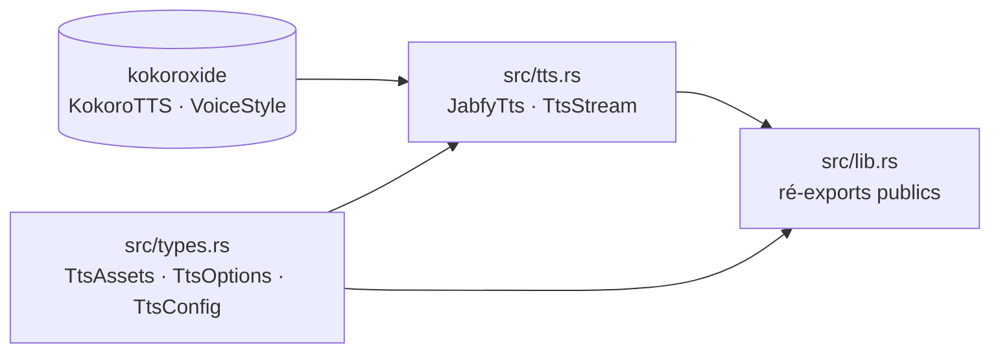

# jabfy-tts — carte des fichiers

> Surcouche ergonomique à kokoroxide : chemins d'assets regroupés, pseudo-streaming par phrase, ré-exports prêts pour jabfy-core.

Tests et CI : [tests.md](../tests.md) · build : [build et CI](build.md)

## Schéma

## À lire d'abord

1. [src/tts.rs](tts.md) — `JabfyTts`, le wrapper autour de `KokoroTTS`, et `TtsStream`, le tampon qui découpe en phrases.
2. [src/types.rs](types.md) — `TtsAssets`, `TtsOptions`, `TtsConfig` : les trois types de configuration.
3. [src/lib.rs](lib.md) — la surface publique du crate : uniquement des ré-exports.

## Tous les fichiers

### `src`

| fichier | rôle | statut |
|---|---|---|
| [src/lib.rs](lib.md) | Racine du crate : déclare les modules et ré-exporte toute l'API publique. | actif |
| [src/tts.rs](tts.md) | `JabfyTts` (moteur + voix), `TtsStream` (tampon + frontières de phrase), `TtsStreamChunk`. | actif |
| [src/types.rs](types.md) | `TtsAssets`, `TtsOptions`, `TtsConfig` et leurs valeurs par défaut. | actif |

### Build et CI

Voir [build et CI](build.md) : `Cargo.toml`, `.cargo/config.toml`, `vendor/`, workflows.

## Hors pages

- `vendor/espeak-ng/espeak-ng.lib` : bibliothèque d'import pré-générée depuis `libespeak-ng.dll` (Windows), pas de page — voir [Installation](../installation.md#windows).
- `Cargo.lock` : lockfile figeant le fork de kokoroxide et l'arbre `ort`.
- `node_modules/`, `target/` : répertoires générés, non documentés.
